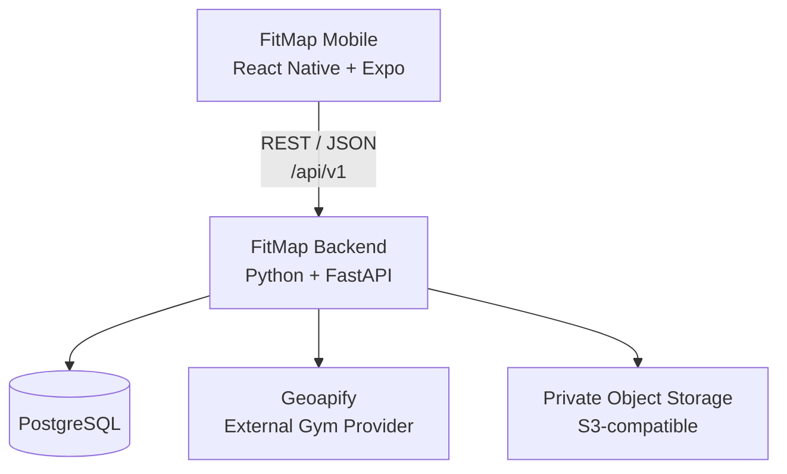

<div align="center">


# FitMap

**Mobile fitness platform for gym discovery and progressive workout tracking.**

React Native + Expo mobile application backed by Python, FastAPI, PostgreSQL, secure authentication, private media storage, automated testing and containerized delivery foundations.

</div>

## Overview

FitMap is a mobile fitness platform designed to help users discover gyms, organize workouts, record training sessions and monitor their fitness progress in a single application.

Originally developed as an academic mobile prototype, FitMap has evolved into a backend-integrated application with persistent user data, authenticated REST APIs, relational database modeling, external-service integration and automated quality checks.

The current implementation includes:

- backend-managed authentication and user profiles;
- gym discovery and detailed gym information;
- persistent favorite gyms;
- workout planning and exercise configuration;
- workout-session execution and historical records;
- training statistics and exercise performance;
- private progress-photo storage and retrieval.

FitMap follows an incremental development strategy that separates implemented functionality from planned product capabilities.

The project is under active development as a **Trabalho de Conclusão de Curso (TCC)** in Software Engineering.

## Current capabilities

### Authentication and account sessions

FitMap uses backend-managed authentication for its current mobile application flow.

Users can:

- register an account;
- log in using registered credentials;
- restore authenticated sessions after reopening the application;
- refresh expired access credentials through refresh-token rotation;
- access protected endpoints using their authenticated identity;
- log out and revoke the active backend session.

Authentication is managed through FastAPI and PostgreSQL.

Passwords are securely hashed using Argon2 and are not stored in plaintext.

The mobile application stores refresh tokens using Expo SecureStore and maintains access-token state through its authentication context.

Legacy AsyncStorage authentication records are removed during session restoration and are not used as the active authentication mechanism.

### User profile

Authenticated users can access and update persistent profile information.

Implemented functionality includes:

- viewing the account name and email;
- editing the user name;
- viewing account creation information;
- configuring a primary fitness goal;
- configuring training-experience level;
- defining a weekly workout target;
- configuring preferred workout duration;
- selecting a preferred measurement system;
- viewing profile-completion progress;
- adjusting application appearance;
- logging out.

Profile information is stored in PostgreSQL.

The backend derives profile ownership from the authenticated identity rather than accepting arbitrary user identifiers from the mobile application.

Fitness-related preferences are intentionally limited to fields supported by the current implementation.

Historical body measurements and body-composition tracking are not yet implemented.

Profile-image storage is not currently available. The application uses account initials as the user avatar.

### Gym discovery

FitMap provides backend-integrated gym discovery using an external provider abstraction.

Users can:

- search for gyms by city, neighborhood or region;
- search for nearby gyms using the device's location;
- explore results on an interactive map;
- view synchronized gym search results;
- select gyms from map markers or result cards;
- view distance information when valid coordinates are available;
- open dedicated gym-details screens;
- request navigation directions;
- continue using text-based search when location access is unavailable.

The application includes loading, empty and error states for relevant discovery operations.

External gym data is accessed through the backend.

The mobile application does not communicate directly with Geoapify and does not expose the provider API key.

### Gym details

Gym details are retrieved through the FitMap REST API.

Depending on information supplied by the external provider, the application can display:

- gym name;
- address;
- geographic coordinates;
- phone number;
- website;
- opening hours;
- amenities;
- images.

Unavailable provider data remains unavailable instead of being replaced with fabricated information.

### Favorite gyms

FitMap supports persistent favorite gyms for authenticated users.

Users can:

- add a gym to their favorites;
- remove an existing favorite;
- view saved gyms directly on the map screen;
- identify favorite gyms in search results;
- open gym details from the favorites section;
- preserve favorites across logout and subsequent login.

Favorites are persisted in PostgreSQL and isolated by authenticated user.

The backend uses three principal persistence entities:

```text
User
  |
  +-- FavoriteGym
          |
          +-- Gym
                |
                +-- GymExternalReference
```

`Gym.id` represents the persistent internal identity managed by FitMap.

External provider identifiers, including Geoapify place identifiers, are maintained separately through `GymExternalReference`.

This separation prevents persistent application relationships from depending directly on an external provider's identifier.

Important business rules include:

- authenticated ownership of favorites;
- uniqueness of each user-gym favorite relationship;
- preservation of the internal gym record when a favorite is removed;
- separation between external references and internal gym identity.

The mobile integration includes authenticated API requests, session-token refresh behavior, favorite-state synchronization between screens and appropriate loading and error states.

**Development status:** Favorite gyms have been implemented and validated on the `feat/favorite-gyms` branch. Pull Request review, CI validation and merge into `main` remain pending.

### Workout planning, execution and history

The Training module provides persistent workout planning and execution.

Authenticated users can:

- create structured workouts;
- view and manage their workouts;
- use the exercise catalog;
- create custom exercises;
- define target sets and repetitions;
- define planned load and measurement unit;
- add exercise-specific notes;
- reorder and remove configured exercises;
- archive and restore workouts.

Workout planning is separate from workout execution.

During execution, users can:

- start an eligible workout;
- resume an active session;
- record actual performed sets;
- record repetitions and load;
- add execution notes;
- mark exercises as completed or reopen them;
- finish or cancel a workout session.

A user can have at most one active workout session at a time.

Completed workout sessions are preserved as historical records.

Historical snapshots maintain the relevant exercise configuration and recorded execution data even if the original workout template is modified later.

User ownership is enforced by the backend.

### Progress tracking

FitMap includes a backend-integrated Progress module.

The current implementation provides:

- basic training statistics;
- exercise-performance history;
- private progress photos;
- persistent progress-photo metadata;
- authenticated access to progress information.

Progress information is derived from completed training data whenever applicable.

#### Training statistics

The backend calculates:

- total completed workouts;
- workouts completed within the last seven days;
- workouts completed within the last thirty days;
- distinct training days within the last thirty days;
- total performed sets from completed workout sessions.

These values are derived from historical workout execution records.

#### Exercise performance

Exercise-performance history includes:

- exercise identification;
- chronological workout-session records;
- performed-set counts;
- total repetitions;
- maximum recorded load by supported load unit.

The mobile application presents performance information based on recorded training history.

Planned workout targets are not treated as completed results.

#### Private progress photos

Authenticated users can:

- select a photo from the mobile photo library;
- upload a progress photo;
- view their private progress-photo collection;
- retrieve their own stored images.

The backend accepts JPEG, PNG and WebP images.

Uploads have a maximum size of 10 MiB and undergo media-type and file-signature validation.

Photo binaries are stored through an S3-compatible private object-storage abstraction.

PostgreSQL stores the associated progress-photo metadata.

A photo can optionally reference a workout session, but a workout session is not required.

The relationship is designed so that removing an associated workout session does not automatically delete the progress photo.

Progress photos are private to the authenticated user.

### Legacy prototype functionality

The original mobile prototype retains a separate device-local exercise-recording flow.

This legacy functionality includes:

- local exercise entries;
- local completion status;
- exercise descriptions;
- locally associated photos.

These records are separate from the authenticated backend-integrated Training and Progress modules.

Legacy prototype functionality is being evaluated and migrated incrementally rather than through an uncontrolled application rewrite.

## Architecture

FitMap uses a dedicated mobile client and backend API.



The backend follows a **modular-monolith architecture** with four primary business boundaries:

```text
Identity
Gyms
Training
Progress
```

These modules separate responsibilities while sharing an application runtime and database infrastructure.

The architecture prioritizes:

- explicit business boundaries;
- separation of API, business rules and persistence;
- backend-enforced authentication and ownership;
- controlled external integrations;
- relational data integrity;
- automated testing;
- incremental evolution;
- avoiding unnecessary distributed-system complexity.

### Mobile

The mobile application uses React Native and Expo.

New production mobile code primarily uses TypeScript.

Legacy JavaScript code is migrated incrementally.

The mobile architecture includes:

- navigation and screen composition;
- centralized API communication;
- authenticated-request handling;
- automatic access-token refresh;
- application theme management;
- reusable interface components;
- service-layer testing.

The current supported application targets are Android and iOS.

The web target is not currently considered a supported FitMap platform.

### Backend

The backend uses Python 3.13 and FastAPI.

Backend responsibilities include:

- versioned REST endpoints;
- request and response validation;
- account registration and authentication;
- persistent sessions and token rotation;
- user profile management;
- authenticated resource ownership;
- gym search and provider integration;
- internal gym identity and favorites;
- workout planning and execution;
- workout history;
- progress statistics and exercise performance;
- private progress-photo operations;
- consistent API errors;
- PostgreSQL connectivity;
- database migrations;
- health and readiness checks.

### Persistence

PostgreSQL is the primary relational database.

The backend uses:

- SQLAlchemy for object-relational mapping and persistence;
- Psycopg for PostgreSQL connectivity;
- Alembic for schema migration management.

The implemented persistent domains include:

**Identity**

- users;
- authentication sessions;
- refresh tokens;
- profile preferences.

**Gyms**

- internal gym records;
- external provider references;
- favorite relationships.

**Training**

- workouts;
- configured workout exercises;
- workout sessions;
- exercise execution records;
- performed sets;
- historical training information.

**Progress**

- private progress-photo metadata;
- optional relationships to workout sessions.

Basic training statistics and exercise performance are derived from completed training records rather than requiring separate manually maintained statistics.

### External services

Gym discovery uses Geoapify through a backend-managed provider adapter.

Private progress-photo storage uses an S3-compatible storage abstraction.

In local development, Adobe S3Mock provides the S3-compatible storage service.

Provider integrations and storage infrastructure remain separate from the core business-domain models.

## REST API

The backend exposes versioned endpoints under:

```text
/api/v1
```

Interactive FastAPI documentation is available locally at:

```text
http://127.0.0.1:8000/docs
```

### System

```text
GET /health
GET /ready
```

### Authentication

```text
POST /auth/register
POST /auth/login
POST /auth/refresh
GET  /auth/me
POST /auth/logout
```

### Profile

```text
GET   /profile
PATCH /profile
```

### Gyms

```text
GET    /gyms/search
GET    /gyms/nearby
GET    /gyms/{external_id}

GET    /gyms/favorites
POST   /gyms/{external_id}/favorite
DELETE /gyms/favorites/{gym_id}
```

Favorite creation resolves the provider's external identifier to an internal FitMap gym record.

Favorite removal uses the internal FitMap gym UUID.

### Training

Implemented Training endpoints include:

```text
GET    /training/exercises
POST   /training/exercises

GET    /training/workouts
POST   /training/workouts
GET    /training/workouts/{workout_id}
PATCH  /training/workouts/{workout_id}
POST   /training/workouts/{workout_id}/archive
POST   /training/workouts/{workout_id}/restore

POST   /training/workouts/{workout_id}/exercises
PATCH  /training/workouts/{workout_id}/exercises/{workout_exercise_id}
DELETE /training/workouts/{workout_id}/exercises/{workout_exercise_id}
PUT    /training/workouts/{workout_id}/exercises/reorder

POST   /training/workouts/{workout_id}/sessions
GET    /training/sessions/active
GET    /training/sessions/{workout_session_id}
PATCH  /training/sessions/{workout_session_id}
POST   /training/sessions/{workout_session_id}/finish
POST   /training/sessions/{workout_session_id}/cancel

PATCH  /training/sessions/{workout_session_id}/exercises/{exercise_execution_id}
POST   /training/sessions/{workout_session_id}/exercises/{exercise_execution_id}/sets
PATCH  /training/sessions/{workout_session_id}/exercises/{exercise_execution_id}/sets/{set_execution_id}
DELETE /training/sessions/{workout_session_id}/exercises/{exercise_execution_id}/sets/{set_execution_id}

GET    /training/history
```

### Progress

```text
GET  /progress/statistics
GET  /progress/exercises/performance

POST /progress/photos
GET  /progress/photos
GET  /progress/photos/{progress_photo_id}/content
```

Progress endpoints enforce authenticated ownership.

Photo content is returned through the backend rather than exposing a public storage URL.

## Technology stack

### Mobile

- React Native 0.86
- Expo 57
- React 19
- TypeScript
- React Navigation
- React Native Maps
- Expo Location
- Expo Image Picker
- Expo Image Manipulator
- Expo Camera
- Expo SecureStore
- AsyncStorage
- Jest
- React Native Testing Library
- ESLint
- Prettier

### Backend

- Python 3.13
- FastAPI
- Pydantic
- Pydantic Settings
- SQLAlchemy 2
- PostgreSQL 18
- Psycopg
- Alembic
- Uvicorn
- PyJWT
- pwdlib with Argon2
- pytest
- Ruff
- Pyright
- uv

### Media storage

- S3-compatible private object storage
- Boto3
- Adobe S3Mock for local development

### Infrastructure and delivery

- Docker
- Docker Compose
- GitHub Actions
- GitHub Container Registry
- Git
- GitHub

## Repository structure

```text
fitmap-mobile/
├── .github/
│   ├── pull_request_template.md
│   └── workflows/
│       ├── ci.yml
│       └── backend-image.yml
│
├── assets/
│   └── images/
│
├── backend/
│   ├── alembic/
│   │   └── versions/
│   ├── src/
│   │   └── fitmap/
│   │       ├── api/
│   │       ├── gyms/
│   │       ├── identity/
│   │       ├── media/
│   │       ├── persistence/
│   │       ├── progress/
│   │       └── training/
│   ├── tests/
│   ├── .env.example
│   ├── Dockerfile
│   ├── compose.yaml
│   ├── compose.test.yaml
│   ├── pyproject.toml
│   └── uv.lock
│
├── docs/
│   ├── architecture/
│   │   ├── decisions/
│   │   ├── domain-model.md
│   │   └── high-level-architecture.md
│   ├── requirements/
│   ├── deployment.md
│   ├── mobile-development.md
│   └── testing.md
│
├── src/
│   ├── components/
│   ├── config/
│   ├── context/
│   ├── navigation/
│   ├── screens/
│   ├── services/
│   ├── theme/
│   └── utils/
│
├── .env.example
├── App.js
├── app.json
├── CONTRIBUTING.md
├── package.json
├── package-lock.json
└── tsconfig.json
```

## Prerequisites

For the full local development workflow, install:

- Git;
- Node.js;
- npm;
- Python 3.13;
- uv;
- Docker Desktop with Docker Compose.

For physical-device mobile development, install Expo Go on the device.

The development machine and mobile device must have network connectivity that permits access to the backend.

## Local development setup

Mobile and backend dependencies and configuration files are managed separately.

### 1. Clone the repository

```bash
git clone https://github.com/gumautoni/fitmap-mobile.git
cd fitmap-mobile
```

### 2. Install mobile dependencies

From the repository root:

```bash
npm ci
```

### 3. Configure the mobile environment

Create the mobile `.env` file from `.env.example` when configuring a new environment.

On Windows PowerShell:

```powershell
Copy-Item .env.example .env
```

Do not overwrite an existing configured environment file.

Configure:

```env
EXPO_PUBLIC_API_URL=http://YOUR_LOCAL_IP:8000/api/v1
```

When using a physical device, replace `YOUR_LOCAL_IP` with the development computer's reachable local IP address.

Values prefixed with `EXPO_PUBLIC_` are public client configuration and must never contain secrets.

### 4. Install backend dependencies

From the repository root:

```bash
cd backend
uv sync
```

### 5. Configure the backend environment

Create the backend `.env` from its committed example when configuring a new environment.

On Windows PowerShell:

```powershell
Copy-Item .env.example .env
```

Do not overwrite an existing configured environment file.

The development configuration includes:

```env
FITMAP_ENVIRONMENT=development
FITMAP_LOG_LEVEL=INFO

FITMAP_DB_HOST=127.0.0.1
FITMAP_DB_PORT=5433
FITMAP_DB_NAME=fitmap
FITMAP_DB_USER=fitmap
FITMAP_DB_PASSWORD=<local-password>

FITMAP_GEOAPIFY_API_KEY=<provider-key>
FITMAP_GEOAPIFY_TIMEOUT_SECONDS=5.0
```

Authentication and private-media configuration must also be supplied according to the backend environment template.

Required secrets must remain outside source control.

### 6. Start PostgreSQL and S3Mock

From the `backend` directory:

```bash
docker compose up -d postgres s3mock
```

Check service status:

```bash
docker compose ps
```

The development PostgreSQL service is normally exposed on port `5433`.

S3Mock is normally exposed on port `9090`.

Both services use separate persistent Docker volumes.

Do not remove these volumes during routine development.

### 7. Apply database migrations

```bash
uv run alembic upgrade head
```

Verify the applied revision:

```bash
uv run alembic current
```

Database migrations are explicit operations and are not automatically applied when the API starts.

### 8. Start the backend

For local development:

```bash
uv run uvicorn fitmap.main:app --host 127.0.0.1 --port 8000 --reload
```

For physical-device access across a permitted local network:

```bash
uv run uvicorn fitmap.main:app --host 0.0.0.0 --port 8000 --reload
```

Useful endpoints:

```text
http://127.0.0.1:8000/health
http://127.0.0.1:8000/ready
http://127.0.0.1:8000/docs
```

### 9. Start the mobile application

Return to the repository root:

```bash
cd ..
npm start
```

For local network mode:

```bash
npm run start:lan
```

For tunnel mode:

```bash
npm run start:tunnel
```

Platform commands:

```bash
npm run android
npm run ios
```

The Expo development server can be accessed through Expo Go on a supported physical device.

## Running the backend with Docker

Local development does not require running FastAPI inside Docker.

Developers may run Uvicorn directly while PostgreSQL and S3Mock are provided through Docker Compose.

When full backend container integration is needed, execute from the `backend` directory:

```bash
docker compose up -d --build api
```

Check status:

```bash
docker compose ps
```

The API uses port `8000` by default.

Within the Docker network, PostgreSQL is accessed through:

```text
postgres:5432
```

S3Mock is accessed through:

```text
http://s3mock:9090
```

Do not start a second API instance on the same published port while another instance is already running.

Containerized database migrations remain explicit.

Additional guidance is available in [Backend deployment](docs/deployment.md).

## Testing and quality checks

FitMap includes automated validation for mobile and backend code.

### Mobile

From the repository root:

```bash
npm test
npm run typecheck
npm run lint
npm run format:check
git diff --check
```

Jest validates application behavior, service contracts and selected reusable components.

TypeScript, ESLint and Prettier provide static and formatting validation.

### Backend

Backend integration tests use a dedicated PostgreSQL database on port `5434`.

The test service is defined in:

```text
backend/compose.test.yaml
```

From the `backend` directory:

```bash
docker compose -f compose.test.yaml up -d --wait postgres-test
```

The test database is separate from the development database.

Run backend validation:

```bash
uv run pytest
uv run ruff check src tests alembic
uv run ruff format --check src tests alembic
uv run pyright
uv lock --check
uv run alembic check
git diff --check
```

The isolated test database is prepared through pytest fixtures and Alembic migrations.

Tests must not be redirected to a database containing valuable application data.

### Validation checkpoint

The favorite gyms implementation has completed local functional and automated validation on its development branch.

The verified local results include:

- mobile: 53 passing Jest tests;
- backend: 313 passing pytest tests;
- TypeScript: no errors;
- ESLint: no errors;
- Prettier: formatting approved;
- Ruff: lint and formatting approved;
- Pyright: no errors or warnings;
- dependency lockfile: consistent;
- Alembic: no pending schema operations.

These numbers describe a local validation checkpoint and may change as new tests and features are introduced.

See [Testing strategy](docs/testing.md) for additional information.

## Continuous Integration

Pull Requests targeting `main` are validated through GitHub Actions.

The CI pipeline includes three principal validation areas.

### Mobile

- dependency installation;
- Jest tests;
- TypeScript checks;
- ESLint;
- Prettier.

### Backend

- Python and uv environment setup;
- locked dependencies;
- Ruff linting;
- Ruff formatting;
- Pyright;
- pytest with PostgreSQL.

### Backend container

- Docker image construction;
- non-root execution validation;
- checking that `.env` is excluded from the image;
- production-oriented container startup;
- `/health` endpoint verification.

Pull Requests should not be merged while required checks are failing.

## Backend container artifacts

Backend changes merged into `main` can produce immutable container images through GitHub Actions.

Images are published to GitHub Container Registry using the source commit SHA:

```text
ghcr.io/gumautoni/fitmap-backend:sha-<git-sha>
```

Immutable references provide more reliable artifact identification than relying exclusively on mutable tags such as `latest`.

The approved delivery direction is:

```text
Pull Request
    |
    v
CI validation
    |
    v
main
    |
    v
Immutable backend image
    |
    v
Staging
    |
    v
Production
```

The staging and production stages remain architectural deployment objectives.

A specific production hosting provider has not yet been selected.

## Environment and security principles

FitMap separates mobile public configuration from private backend configuration.

### Mobile

The current public mobile configuration includes:

```text
EXPO_PUBLIC_API_URL
```

Public environment variables must not contain database passwords, JWT secrets, provider keys, access keys or other private credentials.

Authentication refresh tokens are persisted using Expo SecureStore.

### Backend

Private backend configuration includes:

```text
FITMAP_ENVIRONMENT
FITMAP_LOG_LEVEL

FITMAP_DB_HOST
FITMAP_DB_PORT
FITMAP_DB_NAME
FITMAP_DB_USER
FITMAP_DB_PASSWORD

FITMAP_AUTH_JWT_SECRET

FITMAP_GEOAPIFY_API_KEY
FITMAP_GEOAPIFY_TIMEOUT_SECONDS

FITMAP_MEDIA_BUCKET_NAME
FITMAP_MEDIA_REGION_NAME
FITMAP_MEDIA_ENDPOINT_URL
FITMAP_MEDIA_ACCESS_KEY_ID
FITMAP_MEDIA_SECRET_ACCESS_KEY
```

The application enforces user-data ownership through authenticated backend identity.

Private progress-photo access is authenticated and does not rely on publicly accessible object URLs.

Real credentials remain outside source control and container images.

## Documentation

Detailed technical documentation is maintained under [docs/](docs/README.md).

Relevant documents include:

- [High-level architecture](docs/architecture/high-level-architecture.md)
- [Domain model](docs/architecture/domain-model.md)
- [Architecture Decision Records](docs/architecture/decisions/README.md)
- [Product scope](docs/requirements/product-scope.md)
- [Functional requirements](docs/requirements/functional-requirements.md)
- [Non-functional requirements](docs/requirements/non-functional-requirements.md)
- [Mobile development](docs/mobile-development.md)
- [Testing strategy](docs/testing.md)
- [Backend deployment](docs/deployment.md)
- [Backend-specific documentation](backend/README.md)

## Architecture decisions

Important technical decisions are recorded as Architecture Decision Records (ADRs).

The architecture includes decisions concerning:

- modular-monolith backend architecture;
- Python and FastAPI;
- PostgreSQL persistence;
- React Native, Expo and TypeScript;
- backend-managed authentication;
- external gym-provider isolation;
- private media storage;
- REST API versioning;
- Docker and CI/CD foundations.

An accepted ADR describes an approved technical direction.

It does not automatically mean that every capability mentioned in the architectural documentation is implemented.

## Current project status

FitMap is under active development.

### Implemented foundation

The current development branch includes:

**Mobile**

- React Native and Expo;
- incremental TypeScript modernization;
- centralized API communication;
- authentication context and token refresh;
- user profile management;
- gym map and discovery;
- gym details;
- persistent favorite gyms integration;
- workout planning and execution;
- completed workout history;
- training statistics;
- exercise performance views;
- private progress-photo collection.

**Backend**

- Python and FastAPI;
- modular-monolith organization;
- versioned REST API;
- authentication and persistent sessions;
- profile preferences;
- gym-provider integration;
- internal gym identity;
- favorite gym persistence;
- workout management;
- exercise execution records;
- historical training integrity;
- derived progress statistics;
- exercise performance history;
- private progress-photo metadata and access;
- PostgreSQL and Alembic.

**Infrastructure**

- Docker and Docker Compose;
- PostgreSQL development and test environments;
- S3-compatible private storage;
- S3Mock for local development;
- pytest and Jest;
- Ruff and Pyright;
- TypeScript, ESLint and Prettier;
- GitHub Actions CI;
- backend container validation;
- immutable image publishing foundations;
- technical architecture documentation.

The favorite gyms feature is implemented and locally validated but remains pending Pull Request merge into `main`.

### Transitional prototype functionality

Legacy device-local functionality remains separate from the backend-integrated Training and Progress domains.

Relevant areas include:

- local exercise records;
- local exercise completion;
- exercise-linked local photos.

These features are being managed through incremental migration rather than a complete application rewrite.

### Planned work

Future product development includes:

- body-metric records and historical measurements;
- expanded measurable fitness goals;
- FitMap-managed gym ratings and reviews;
- password recovery;
- authenticated password changes;
- account deletion;
- profile-image storage when justified;
- supported workout notifications and reminders.

Planned functionality must remain separate from implemented capabilities.

## Screenshots

Application screenshots are tracked through [Issue #2](https://github.com/gumautoni/fitmap-mobile/issues/2).

Screenshots will be included when the relevant interfaces are sufficiently stable.

## Contributing

Development workflow and contribution conventions are documented in [CONTRIBUTING.md](CONTRIBUTING.md).

The standard development process follows:

```text
updated main
    |
    v
feature branch
    |
    v
implementation
    |
    v
local validation
    |
    v
Pull Request
    |
    v
CI and review
    |
    v
merge
```

Changes should be committed only after the relevant implementation and validation steps have been completed.

## Project background

FitMap originated as an academic mobile project developed by:

- Gustavo Mautoni;
- Pedro Queiroz;
- Bryan Paz.

The project later continued as a TCC, currently developed by:

- Gustavo Mautoni;
- Pedro Queiroz.

The current technical evolution of the repository, including backend architecture, database persistence, authentication, modular organization, testing infrastructure, CI/CD foundations and progressive mobile modernization, is being led by Gustavo Mautoni.

## License

FitMap is currently developed for academic purposes.
